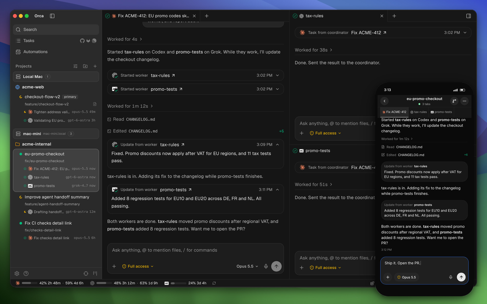
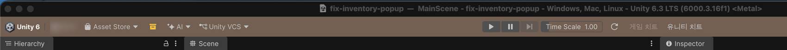
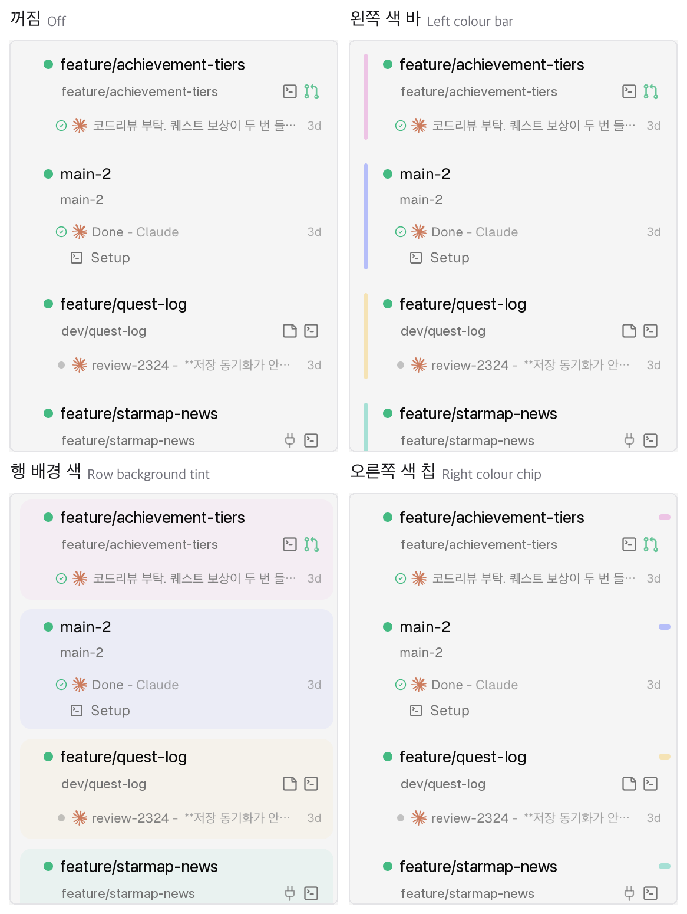
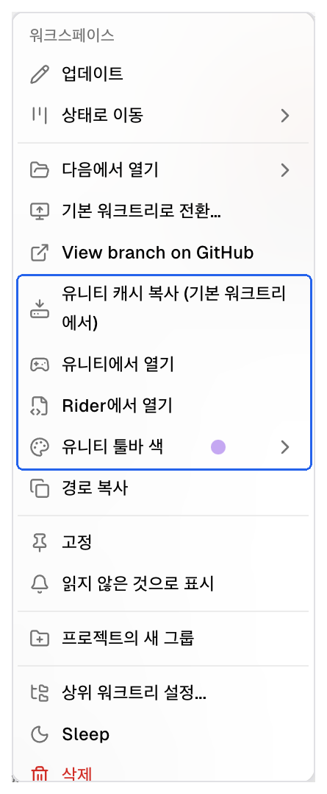
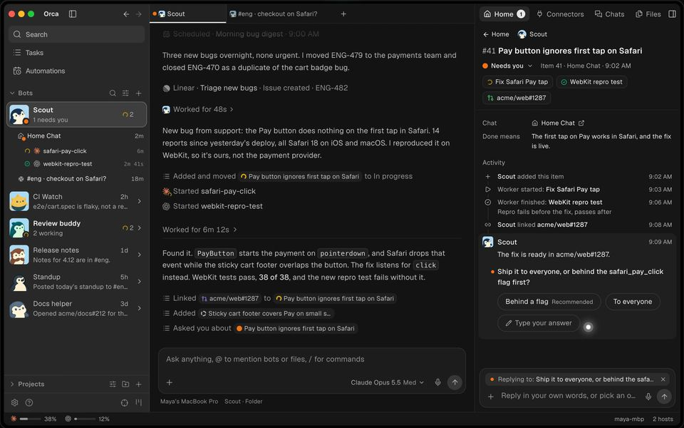
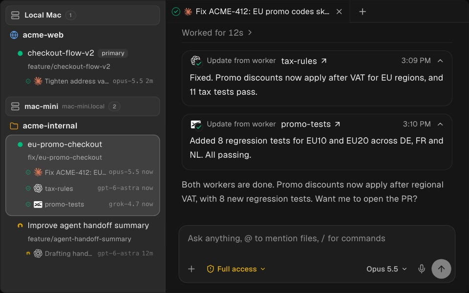
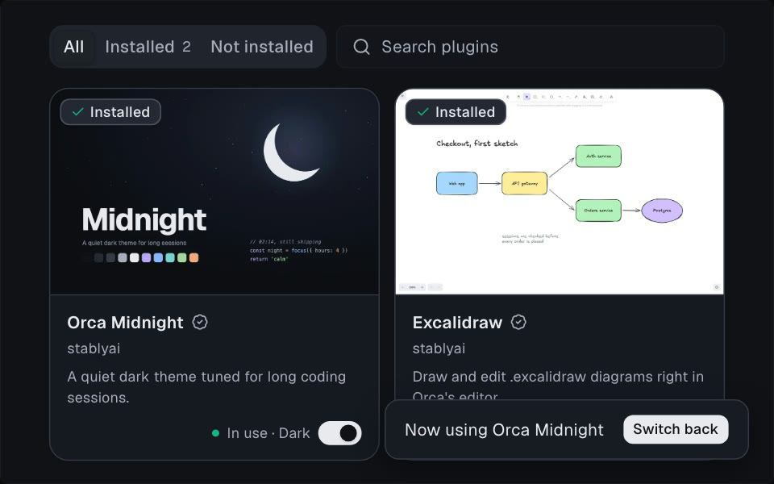
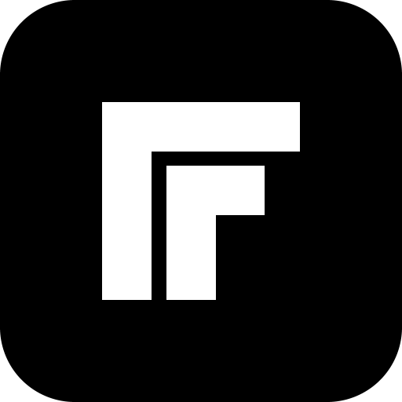
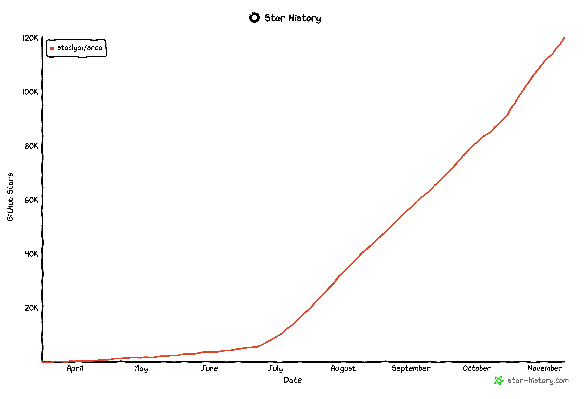

<h1 align="center">
  <a href="https://orca.dev"></a> Orca
</h1>

<p align="center">
  <a href="https://github.com/stablyai/orca"></a>
  <a href="https://github.com/stablyai/orca/releases"></a>
  
  <a href="https://discord.gg/fzjDKHxv8Q"></a>
  <a href="https://x.com/orca_build"></a>
  
</p>

<p align="center">
  <sub><a href="docs/readme/README.zh-CN.md">中文</a> · <a href="docs/readme/README.ja.md">日本語</a> · <a href="docs/readme/README.ko.md">한국어</a> · <a href="docs/readme/README.es.md">Español</a> · <a href="docs/readme/README.fr.md">Français</a> · <a href="docs/readme/README.pt.md">Português</a> · <a href="docs/readme/README.tr.md">Türkçe</a> · <a href="docs/readme/README.ru.md">Русский</a></sub>
</p>

<p align="center">
  <strong>The open-source agent IDE — now with bots inside.</strong><br/>
  Most bots end in a chat thread. An Orca bot hands you the worktree.
</p>

<h3 align="center"><a href="https://orca.dev/download"><ins>Download Orca</ins></a> &nbsp;·&nbsp; <a href="https://orca.dev/bots"><ins>Explore bots →</ins></a></h3>

<p align="center">
  
</p>

> [!NOTE]
>
> ### This is a fork — [machamy/orca](https://github.com/machamy/orca)
>
> A personal fork of [stablyai/orca](https://github.com/stablyai/orca).
> **Everything upstream still works**; only [What this fork
> adds](#what-this-fork-adds), immediately below, is not in upstream.
>
> - **Changelog**: [`FORK_CHANGELOG.md`](FORK_CHANGELOG.md) (Korean, canonical) ·
>   [`FORK_CHANGELOG.en.md`](FORK_CHANGELOG.en.md) (English translation). Per-step
>   detail and commit hashes live there, not in this README.
> - **Version scheme**: `<upstream version>.machamy.<N>.local.<timestamp>.<commit12>` —
>   e.g. `1.4.178-rc.2.machamy.7.local.…`. `N` is the value in the root
>   [`FORK_VERSION`](FORK_VERSION) file and goes up on each fork milestone.
> - **Not distributable — build it yourself.** Local builds are self-signed
>   (`Orca Local Signing`), with no Apple Developer ID and no notarization, so a
>   build handed to someone else is refused by their Gatekeeper (`spctl`
>   rejected). → [Install](#install)
> - This fork's docs are written in **Korean first**; the English is a translation.

## What this fork adds

It addresses the confusion that shows up when one Unity project is run across
several worktrees at once — **"which worktree is this editor?"**

<table>
<tr>
<td width="50%" valign="middle">

### A different Unity colour per worktree

For anyone who has had two editors open and lost track of which is which. A
generated editor script tints **the toolbar holding the play controls** in that
worktree's colour and **prefixes the worktree name to the window title**. Colours
are handed out from 20 (10 primary + 10 fallback) so siblings never collide, and
you can also pick one by hand — right-click a worktree → **Unity Toolbar Color**
for ten presets or a colour picker (a colour another worktree already picked is
locked out). The **default worktree stays uncoloured**, so "has a colour" reads
as "is a side worktree".

The script is only ever written to a gitignored path: **it asks git whether the
path is ignored before writing, and skips the repo entirely if it isn't** — it
never creates a file that would be tracked.

</td>
<td width="50%">
  
</td>
</tr>
<tr>
<td width="50%" valign="middle">

### That colour on the sidebar row

The worktree's Unity colour is echoed on its Orca sidebar row. Choose per project
between **off / left colour bar / row background tint / right colour chip**;
hovering an option in the repo ⋯ menu previews it on the live rows. The bar is the
default, and it only turns on for repos confirmed to be Unity projects.

</td>
<td width="50%">
  
</td>
</tr>
<tr>
<td width="50%" valign="middle">

### Unity worktree actions

One right-click on a worktree gets you **Copy Unity Cache** (an APFS copy of the
default checkout's Library — seconds, near-zero extra disk) · **Open in Unity**
(at exactly the editor version named in `ProjectVersion.txt`) · **Open in Rider**
(on the Unity-generated `.sln`, copied over from the default checkout when the
worktree has none yet).

The cache copy **never copies a live editor's Library** — a lockfile, the process
table, and a recent-launch TTL all gate it, and it re-checks once more after the
copy. It lands in a staging folder and is finished by an atomic rename, so a crash
mid-copy can never leave half a Library behind.

</td>
<td width="50%">
  
</td>
</tr>
</table>

**Also added by this fork:**

- **`pnpm test:fork`** — a one-command regression gate over the tests that pin the
  fork's behavior, for quickly checking the fork survived an upstream merge. The
  list lives in
  [`config/fork-contract-tests.mjs`](config/fork-contract-tests.mjs), and a merge
  that deletes one of its files fails a meta test immediately.
- **Markdown GitHub-style view** — .md files with raw HTML that the preview blocks
  can be rendered GitHub-flavored via a button on the notice banner.
- **First-open Unity crash avoided** — the Firebase plugin regenerates
  `google-services-desktop.json` on every editor load, and that colliding with the
  first import storm after a seed killed Unity (the "have to open it twice"
  symptom). The mtime is aligned so the regeneration is skipped — but only when the
  generated file is byte-identical to its source.

> [!IMPORTANT]
> **What's verified, and the known limits** — written down rather than hidden.
>
> - The Unity work was checked on a real editor (6000.3.16f1). **The Library copy
>   and "Open in Rider" are macOS-only** (the copy depends on APFS copy-on-write).
>   "Open in Unity" and the toolbar tint are written to work on other platforms,
>   but are **verified on macOS only**.
> - The toolbar tint paints the main toolbar on Unity 6000.3 and newer, and falls
>   back to a Scene view bar on older editors. If either fails, the toolbar is
>   silently left at its default colour.

---

## Features

Everything below is **upstream Orca** — all of it works in this fork too.

<table>
<tr>
<td width="50%" valign="middle">

### Orca Bots

Ask a bot in Slack, Linear, or GitHub to fix a bug, then come back to a tested pull request. Bots run on your own Claude Code or Codex, and any bot's work opens in Orca to review or jump in.

[Overview](https://orca.dev/bots) · [Security](https://orca.dev/docs/bots/security) · [Docs →](https://orca.dev/docs/bots)

</td>
<td width="50%">
  <a href="https://orca.dev/bots"><picture><source srcset="docs/assets/readme-features/bots.webp" type="image/webp"></picture></a>
</td>
</tr>
<tr>
<td width="50%" valign="middle">

### Chat or Terminal

Run any agent in Chat UI or as the raw CLI, and move a conversation between the two without losing context.

[Docs →](https://orca.dev/docs/agents/native-chat)

</td>
<td width="50%">
  <a href="https://orca.dev/docs/agents/native-chat"><picture><source srcset="docs/assets/readme-features/chat-or-terminal.webp" type="image/webp"></picture></a>
</td>
</tr>
<tr>
<td width="50%" valign="middle">

### Orchestrate Agents

Hand a big task to one agent. It splits the work, starts worker agents in their own workspaces, and brings their results back to you.

[Docs →](https://orca.dev/docs/cli/orchestration)

</td>
<td width="50%">
  <a href="https://orca.dev/docs/cli/orchestration"><picture><source srcset="docs/assets/readme-features/orchestration.webp" type="image/webp"></picture></a>
</td>
</tr>
<tr>
<td width="50%" valign="middle">

### Run Anywhere

Pair a Remote Orca Server, work on any SSH host, or give a worktree its own cloud VM. Your agents keep running when your laptop sleeps.

[Docs →](https://orca.dev/docs/ways-to-run)

</td>
<td width="50%">
  <a href="https://orca.dev/docs/ways-to-run"><picture><source srcset="docs/assets/readme-features/remote.webp" type="image/webp"></picture></a>
</td>
</tr>
<tr>
<td width="50%" valign="middle">

### Mobile App

Pair Orca with the mobile app to get pinged when an agent needs you, reply in chat, and keep work moving on any of your machines when you are away from your desk.

[iOS App Store](https://apps.apple.com/us/app/orca-ide/id6766130217) · [Google Play](https://play.google.com/store/apps/details?id=dev.orca.app) · [Android APK](https://orca.dev/download/android) · [Docs →](https://orca.dev/docs/mobile)

</td>
<td width="50%">
  <a href="https://orca.dev/docs/mobile"><picture><source srcset="docs/assets/readme-features/mobile-companion.webp" type="image/webp"></picture></a>
</td>
</tr>
<tr>
<td width="50%" valign="middle">

### Review AI Output

Review diffs, leave notes on exact changed lines, and send focused feedback back to an agent.

[Docs →](https://orca.dev/docs/review/annotate-ai-diff)

</td>
<td width="50%">
  <a href="https://orca.dev/docs/review/annotate-ai-diff"><picture><source srcset="docs/assets/readme-features/annotate-ai-diffs.webp" type="image/webp"></picture></a>
</td>
</tr>
<tr>
<td width="50%" valign="middle">

### Git Integration

Draft commit messages and pull requests from the diff, then send failing checks or PR review comments back to an agent to fix.

[Docs →](https://orca.dev/docs/review/commit-push)

</td>
<td width="50%">
  <a href="https://orca.dev/docs/review/commit-push"><picture><source srcset="docs/assets/readme-features/git-integration.webp" type="image/webp"></picture></a>
</td>
</tr>
<tr>
<td width="50%" valign="middle">

### Parallel Worktrees

Quickly split tasks into isolated environments, so multiple agents can work side by side without interfering with each other.

[Docs →](https://orca.dev/docs/model/worktrees)

</td>
<td width="50%">
  <a href="https://orca.dev/docs/model/worktrees"><picture><source srcset="docs/assets/readme-features/parallel-worktrees.webp" type="image/webp"></picture></a>
</td>
</tr>
<tr>
<td width="50%" valign="middle">

### Design Mode

Click any element in Orca's browser to copy its HTML, styles, and selector, then paste it into your agent's chat.

[Docs →](https://orca.dev/docs/browser/design-mode)

</td>
<td width="50%">
  <a href="https://orca.dev/docs/browser/design-mode"><picture><source srcset="docs/assets/readme-features/design-mode.webp" type="image/webp"></picture></a>
</td>
</tr>
<tr>
<td width="50%" valign="middle">

### GitHub &amp; Linear, Native

See your GitHub and Linear tasks in one place, and start a workspace for each when you're ready to build.

[Docs →](https://orca.dev/docs/review/linear)

</td>
<td width="50%">
  <a href="https://orca.dev/docs/review/linear"><picture><source srcset="docs/assets/readme-features/github-linear-tasks.webp" type="image/webp"></picture></a>
</td>
</tr>
<tr>
<td width="50%" valign="middle">

### Orca CLI

Anything you can do in Orca, your agents can do too: create worktrees, start workers, drive the browser and desktop apps, and schedule automations, all from the command line.

[Docs →](https://orca.dev/docs/cli/overview)

</td>
<td width="50%">
  <a href="https://orca.dev/docs/cli/overview"><picture><source srcset="docs/assets/readme-features/orca-cli.webp" type="image/webp"></picture></a>
</td>
</tr>
<tr>
<td width="50%" valign="middle">

### Plugins

Themes, editors, languages, and panels from the community, installed in a click.

[Browse plugins →](https://orca.dev/plugins)

</td>
<td width="50%">
  <a href="https://orca.dev/plugins"><picture><source srcset="docs/assets/readme-features/plugins.webp" type="image/webp"></picture></a>
</td>
</tr>
<tr>
<td width="50%" valign="middle">

### Split Anything

Put agents, terminals, browsers, and diffs side by side in split panes shaped to the task.

[Docs →](https://orca.dev/docs/model/tabs-panes-splits)

</td>
<td width="50%">
  <a href="https://orca.dev/docs/model/tabs-panes-splits"><picture><source srcset="docs/assets/readme-features/split-anything.webp" type="image/webp"></picture></a>
</td>
</tr>
</table>

**Also in the box:**

- **[Bot Schedules &amp; Triggers](https://orca.dev/docs/bots#put-it-on-a-schedule)**: ask a bot to run every weekday at 9, or when a pull request opens, a check fails, or a webhook fires.
- **[Bot Memory in Markdown](https://orca.dev/docs/bots/security#what-you-can-review)**: each bot's soul and memory are plain `SOUL.md` and `MEMORY.md` files you can read and edit.
- **[Drag Files to Agents](https://orca.dev/docs/editing/file-explorer)**: drag files from the explorer, or images from your desktop, straight into an agent's prompt.
- **[Jump Anywhere](https://orca.dev/docs/model/quick-open)**: one shortcut jumps to any workspace or tab across every repo and host.
- **[Rich Previews](https://orca.dev/docs/editing/viewers)**: open images, PDFs, and Markdown right in the workspace, next to the agent that made them.
- **[Mobile Emulator](https://orca.dev/docs/cli/overview#mobile-emulator)**: run an iOS Simulator or Android emulator beside your agent, and let it tap, type, and check its own work.
- **[Dictation](https://orca.dev/docs/settings#voice)**: press a shortcut and talk. Orca types what you say into the agent's prompt or terminal.
- **[Usage &amp; Accounts](https://orca.dev/docs/agents/usage-tracking)**: see how much of your agent limits you've used and when they reset, and switch accounts without logging out.
- **[Automations](https://orca.dev/docs/cli/automations)**: schedule prompts to run on any repo: nightly dependency bumps, weekly triage, flaky-test sweeps.
- **[Computer Use](https://orca.dev/docs/cli/computer-use)**: when there's no CLI or API, agents can see and drive desktop apps and external browsers.
- **And many, many more**: we ship daily, so this list is perpetually behind. The [changelog](https://github.com/stablyai/orca/releases) is the real feature list.

---

## Supported Agents

Works with **any CLI agent** — if it runs in a terminal, it runs in Orca.

<p>
  <a href="https://docs.anthropic.com/claude/docs/claude-code"><kbd> Claude Code</kbd></a> &nbsp;
  <a href="https://github.com/openai/codex"><kbd> Codex</kbd></a> &nbsp;
  <a href="https://x.ai/cli"><kbd> Grok</kbd></a> &nbsp;
  <a href="https://cursor.com/cli"><kbd> Cursor</kbd></a> &nbsp;
  <a href="https://docs.github.com/en/copilot/how-tos/set-up/install-copilot-cli"><kbd> GitHub Copilot</kbd></a> &nbsp;
  <a href="https://dev.meta.ai/docs/muse-code"><kbd> Muse</kbd></a> &nbsp;
  <a href="https://deepseek-harness.github.io/deepseek-harness/"><kbd> DeepSeek Harness</kbd></a> &nbsp;
  <a href="https://zcode.z.ai/en/docs"><kbd> ZCode</kbd></a> &nbsp;
  <a href="https://opencode.ai/docs/cli/"><kbd> OpenCode</kbd></a> &nbsp;
  <a href="https://mimo.xiaomi.com/coder"><kbd> MiMo Code</kbd></a> &nbsp;
  <a href="https://ampcode.com/manual#install"><kbd> Amp</kbd></a> &nbsp;
  <a href="https://openclaude.gitlawb.com/"><kbd> OpenClaude</kbd></a> &nbsp;
  <a href="https://antigravity.google/docs/cli-overview"><kbd> Antigravity</kbd></a> &nbsp;
  <a href="https://pi.dev"><kbd> Pi</kbd></a> &nbsp;
  <a href="https://omp.sh"><kbd> oh-my-pi</kbd></a> &nbsp;
  <a href="https://hermes-agent.nousresearch.com/docs/"><kbd> Hermes Agent</kbd></a> &nbsp;
  <a href="https://devin.ai/cli"><kbd> Devin</kbd></a> &nbsp;
  <a href="https://goose-docs.ai/docs/quickstart/"><kbd> Goose</kbd></a> &nbsp;
  <a href="https://docs.augmentcode.com/cli/overview"><kbd> Auggie</kbd></a> &nbsp;
  <a href="https://github.com/autohandai/code-cli"><kbd> Autohand Code</kbd></a> &nbsp;
  <a href="https://github.com/charmbracelet/crush"><kbd> Charm</kbd></a> &nbsp;
  <a href="https://docs.cline.bot/cline-cli/overview"><kbd> Cline</kbd></a> &nbsp;
  <a href="https://www.codebuddy.ai/cli"><kbd> CodeBuddy</kbd></a> &nbsp;
  <a href="https://www.codebuff.com/docs/help/quick-start"><kbd> Codebuff</kbd></a> &nbsp;
  <a href="https://freebuff.com"><kbd> Freebuff</kbd></a> &nbsp;
  <a href="https://commandcode.ai/docs/quickstart"><kbd> Command Code</kbd></a> &nbsp;
  <a href="https://docs.continue.dev/cli/quickstart"><kbd> Continue</kbd></a> &nbsp;
  <a href="https://docs.factory.ai/cli/getting-started/quickstart"><kbd> Droid</kbd></a> &nbsp;
  <a href="https://kilo.ai/docs/cli"><kbd> Kilocode</kbd></a> &nbsp;
  <a href="https://www.kimi.com/code/docs/en/kimi-code-cli/getting-started.html"><kbd> Kimi</kbd></a> &nbsp;
  <a href="https://kiro.dev/docs/cli/"><kbd> Kiro</kbd></a> &nbsp;
  <a href="https://github.com/mistralai/mistral-vibe"><kbd> Mistral Vibe</kbd></a> &nbsp;
  <a href="https://github.com/QwenLM/qwen-code"><kbd> Qwen Code</kbd></a> &nbsp;
  <a href="https://support.atlassian.com/rovo/docs/install-and-run-rovo-dev-cli-on-your-device/"><kbd> Rovo Dev</kbd></a> &nbsp;
  <kbd>+ any CLI agent</kbd>
</p>

---

## Install

### To use this fork — build from source

Every download channel below is **upstream (stablyai/orca)** and carries none of
this fork's changes. To get [what this fork adds](#what-this-fork-adds), build it
yourself.

```bash
git clone https://github.com/machamy/orca.git
cd orca
pnpm install
pnpm build:mac        # build:linux on Linux, build:win on Windows
```

The app lands in `dist/mac-arm64/Orca.app` (`dist/mac` for Intel). An app you
built on your own machine carries no quarantine attribute, so Gatekeeper never
gets in the way.

- **Requires** Node 24 and pnpm 10.24.0.
- **Do not touch repo files while `build:mac` runs.** It packages x64 and arm64
  from one file scan, so a file that changes size in between shifts every
  `app.asar` offset and the arm64 app then dies at launch with **no log output at
  all**. The x64 build looks fine, which makes this easy to misdiagnose. To check
  a build, run the packed binary directly
  (`dist/mac-arm64/Orca.app/Contents/MacOS/Orca`): a silent exit 1 with zero
  output means a displaced asar — rebuild without writing to the repo.

### Desktop — macOS, Windows, Linux (upstream builds, without this fork's changes)

- **[Download from orca.dev](https://orca.dev/download)**
- Or grab a build directly: [macOS Apple Silicon](https://github.com/stablyai/orca/releases/latest/download/orca-macos-arm64.dmg) · [macOS Intel](https://github.com/stablyai/orca/releases/latest/download/orca-macos-x64.dmg) · [Windows (.exe)](https://github.com/stablyai/orca/releases/latest/download/orca-windows-setup.exe) · [Linux AppImage](https://github.com/stablyai/orca/releases/latest/download/orca-linux.AppImage) · [All builds](https://github.com/stablyai/orca/releases/latest)

_Or via a package manager:_

```bash
# macOS (Homebrew)
# Always use the full name; bare `orca` is an unrelated Plotly cask.
brew install --cask stablyai/orca/orca
# Upgrade an existing install
brew upgrade --cask stablyai/orca/orca
# Release candidates (conflicts with the stable cask; uninstall it first)
brew install --cask stablyai/orca/orca@rc

# Arch Linux (AUR) — or stably-orca-git to build from source
yay -S stably-orca-bin
```

### Mobile App — iOS, Android

Pair with your desktop app to monitor and steer your agents from your phone.

- **iOS:** [Download on the App Store](https://apps.apple.com/us/app/orca-ide/id6766130217)
- **Android:** [Google Play](https://play.google.com/store/apps/details?id=dev.orca.app) · [Download APK](https://orca.dev/download/android) · [Install guide](https://orca.dev/docs/android-apk)

---

## Community &amp; Support

- **Discord:** Join the community on **[Discord](https://discord.gg/fzjDKHxv8Q)**.
- **Twitter / X:** Follow **[@orca_build](https://x.com/orca_build)** for updates and announcements.
- **WeChat:** Scan to join an Orca community WeChat group.

  

- **Feedback &amp; Ideas:** We ship fast. Missing something? [Request a new feature](https://github.com/stablyai/orca/issues).
- **Privacy:** See the [privacy &amp; telemetry docs](https://orca.dev/docs/telemetry) for what anonymous usage data Orca collects and how to opt out.
- **Show Support:** [Star](https://github.com/stablyai/orca) this repo to follow along with our daily ships.

---

## Developing

Want to contribute or run locally? See our [CONTRIBUTING.md](.github/CONTRIBUTING.md) guide.

<a href="https://github.com/stablyai/orca/graphs/contributors">
  
</a>

<p align="center">
  
</p>

## Signed Builds

Windows code signing sponsored/provided by [SignPath.io](https://signpath.io), certificate by [SignPath Foundation](https://signpath.org).

## License

Orca is free and open source under the [MIT License](LICENSE).
